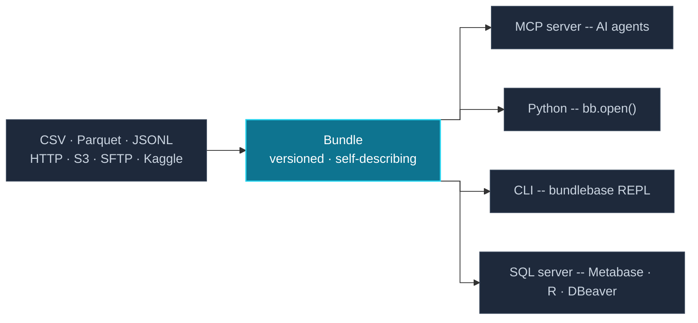

Hand an AI agent a CSV and it will write SQL that looks right. Whether the number comes back right is a separate question. A schema says a column is called `amt` and holds a number. It doesn't say the value is net of refunds, that the rows only cover Q1, or what your company means by "revenue".

Bundlebase packages data into a versioned container that carries all of that: what each column means, how your metrics are defined, where every row came from, and every transformation applied along the way. Run it as an MCP server and an agent reads the whole thing in one call.

The same container works for people. Point anyone at the path and they get a DataFrame, a SQL connection, or Metabase.

## Data an agent can query correctly

Describe the columns and define the metrics once. Both live in the bundle, versioned like any other change, and travel with it.

=== "SQL"

    ```sql
    DESCRIBE COLUMN amount AS 'order total in USD, net of refunds';
    CREATE METRIC total_revenue AS 'SUM(amount)' DESCRIPTION 'gross revenue in USD';
    ```

=== "Python"

    ```python
    bundle.describe_column("amount", "order total in USD, net of refunds")
    bundle.define_metric("total_revenue", "SUM(amount)", "gross revenue in USD")
    ```

Then serve the bundle:

```bash
bundlebase mcp --bundle s3://company-data/sales-q1
```

The agent calls `describe` once and gets the schema with those descriptions, the metric definitions, the source of every file, and the commit history. When it needs revenue it calls `metric(name="total_revenue")` and computes your definition instead of inventing its own `SUM`.

A bundle will also refuse to answer wrongly. CSV and JSONL columns import as text, so `data_quality` reports which of them actually hold numbers or dates and what to cast them to. And comparing a text column against a number is rejected rather than compared as strings — the failure where `WHERE amount > 50` quietly matches `"9"` and drops `"100"`.

[The agent use case ->](use-cases/llm-agent.md) · [Semantic model ->](guide/semantic-model.md)

## Receipts for every number

An answer is only as good as the data behind it. A bundle records where every row came from and everything that has happened to it since, so any number can be traced back.

```sql
SHOW HISTORY;        -- every commit: who, when, why, and the exact operations
SELECT source_locations, source_versions, num_rows
  FROM bundle_info.blocks;   -- the source files and versions behind fetched data
VERIFY DATA;         -- confirm attached files still match the checksums recorded at attach
```

An agent gets the same record from `describe` and `history` over MCP. Ask it where a number came from and it can name the files, the commits that changed them, and the definition it used. Deletes and updates are recorded as changes with the `WHERE` clause that produced them, never as silent rewrites.

The record is plain files in the bundle directory: YAML manifests and Parquet data, with no catalog service to keep running. [What a bundle looks like on disk ->](guide/bundle-format.md)

## Agents keep their context between sessions

Agents lose context. A bundle doesn't. The next session opens the last committed state and reads what it already has, without re-fetching anything. If a run dies halfway through there is no partial data to clean up — the bundle sits at its last commit.

=== "Python"

    ```python
    # New session -- reconstruct from the bundle itself
    bundle = bb.open("s3://agent-workspace/product-reviews")
    print(bundle.name)        # "Product Reviews"
    print(bundle.num_rows())  # 14302
    for e in bundle.history():
        print(e)              # what ran, and when

    results = bundle.query(
        "SELECT * FROM bundle WHERE review_date >= '2026-01-01'"
    ).to_pandas()
    ```

=== "MCP"

    ```bash
    bundlebase mcp --bundle s3://agent-workspace/product-reviews
    ```

    The agent gets `describe`, `analyze`, `query`, `metric`, `data_quality`,
    `sample`, and `history` as native tools. `describe` is the one to call
    first — it answers "what is this data, where did it come from, and what
    has been done to it" in a single response.

## Share a dataset with your team

Email a CSV and it's stale by Friday. Re-run the pipeline yourself, every time. Stand up a database, and that's a quarter of work.

=== "Python"

    ```python
    import bundlebase.sync as bb

    bundle = (bb.create("s3://company-data/sales-q1")
        .attach("exports/jan.csv")
        .attach("exports/feb.csv")
        .drop_column("ssn")
        .filter("SELECT * FROM bundle WHERE status = 'closed_won'")
        .set_name("Q1 Sales -- Closed Won"))
    bundle.commit("Initial Q1 export")

    # Anyone with the path
    bundle = bb.open("s3://company-data/sales-q1")
    df = bundle.to_pandas()
    ```

=== "SQL"

    ```sql
    ATTACH 'exports/jan.csv';
    ATTACH 'exports/feb.csv';
    DROP COLUMN ssn;
    FILTER WITH SELECT * FROM bundle WHERE status = 'closed_won';
    SET NAME 'Q1 Sales -- Closed Won';
    COMMIT 'Initial Q1 export';
    ```

    ```bash
    # Anyone with the path
    bundlebase query --bundle s3://company-data/sales-q1 \
      "SELECT region, SUM(amount) FROM bundle GROUP BY region"
    ```

Commit once. Share the path. The consumer gets a DataFrame, a SQL connection, or a CLI session, whichever they prefer. The commit history *is* the changelog. No "which file is the latest?" conversations.

[Sharing a dataset ->](use-cases/sharing-datasets.md) · [What makes a bundle different from a Parquet file ->](getting-started/why-bundlebase.md)

## Data hygiene rules that travel with the bundle

Your source data is dirty. You clean it every time, until you forget. `always_delete` and `always_update` encode cleanup rules into the bundle itself. They fire on every future attach, regardless of who runs it.

=== "Python"

    ```python
    bundle = bb.create("s3://analytics/crm-export")

    # Define once
    bundle.always_delete("amount < 0")
    bundle.always_delete("status = 'test'")

    # Attach dirty data -- rules fire automatically
    bundle.attach("jan.csv").commit("January")
    bundle.extend().attach("feb.csv").commit("February")
    ```

=== "SQL"

    ```sql
    ALWAYS DELETE FROM bundle WHERE amount < 0;
    ALWAYS DELETE FROM bundle WHERE status = 'test';

    -- attach dirty data -- rules fire automatically
    ATTACH 'jan.csv';
    COMMIT 'January';
    ```

No shared cleanup script. No "oops, I forgot the filter" incidents.

[See the scheduled collection use case ->](use-cases/scheduled-collection.md)

## How it works



## Works with your stack

| | |
|---|---|
| **AI agents** | MCP server -- Claude, Copilot, or any MCP-compatible assistant. `bundlebase setup-agent` writes the config for you |
| **Python** | `pandas` · `polars` · `numpy` · `pyarrow`, sync + async |
| **CLI** | Interactive REPL, scriptable commands -- no Python required |
| **BI tools** | Metabase · DBeaver · R · Julia · Go -- anything with an Arrow Flight driver or native Arrow Flight support. Column descriptions travel as Arrow field metadata |
| **Storage** | S3 · GCS · Azure Blob · local paths |
| **Formats** | Parquet · CSV · JSONL (newline-delimited JSON) -- mixed sources union automatically; other JSON shapes via [connectors](guide/sources.md#json-options) |
| **Extending** | [Custom connectors](guide/custom-connectors/index.md) for sources with no built-in support, and [custom SQL functions](guide/functions.md) |
| **SQL** | Full Apache DataFusion syntax -- `SELECT * FROM bundle WHERE ...` |
| **Scale** | Streaming execution -- datasets larger than RAM, constant memory |
| **Core** | Rust + Apache Arrow -- columnar, fast |

## Get started

1. [Set up an AI assistant](use-cases/llm-agent.md) -- run `bundlebase setup-agent`, then ask questions about a bundle
2. [Why Bundlebase?](getting-started/why-bundlebase.md) -- comparisons to plain files, DVC, and Delta Lake / Iceberg
3. [Python](getting-started/python/install.md) -- pip install, then build your first bundle
4. [CLI](getting-started/cli/install.md) -- download the binary, query interactively
