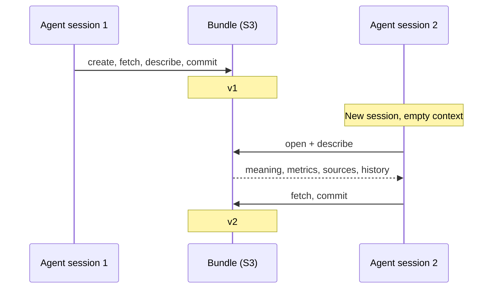

# Use Case: Agent Workspaces

## The problem

An agent doing ongoing work collects data as it goes: reviews scraped from an API, prices checked daily, results from each run. Between sessions its context resets. At the start of the next session it has to answer three questions before it can do anything useful. What data do I already have? Where did it come from? What did I do last time?

The usual answers are all fragile. Re-fetching everything is slow and may not return the same data. A notes file the agent wrote itself may be stale, incomplete, or missing if the last session crashed. A database needs a server the agent can reach from wherever it happens to be running.

A bundle answers all three from the data itself. It lives at a path, opens with one call, and carries its own record of every fetch and every change.

## The scenario

An agent tracks competitor product reviews. Each session it pulls new reviews from an API, cleans them, and answers questions about trends. It runs as a short-lived process: sometimes in Claude Code on a laptop, sometimes in a scheduled CI job.

## First session: create the workspace

=== "Python"

    ```python
    import bundlebase.sync as bb

    bundle = (bb.create("s3://agent-workspace/product-reviews")
        .set_name("Product Reviews")
        .set_description("Competitor product reviews from api.example.com, deduplicated by review_id")
        .create_source("http", {
            "url": "https://api.example.com/reviews",
            "json_record_path": "data"
        }))
    bundle.fetch("base", "add")

    bundle.describe_column("rating", "1 to 5 stars; 0 means the reviewer left no rating")
    bundle.define_metric("avg_rating", "AVG(CASE WHEN rating > 0 THEN rating END)",
                         "mean star rating, excluding unrated reviews")
    bundle.commit("Initial fetch")
    ```

=== "SQL"

    ```sql
    SET NAME 'Product Reviews';
    SET DESCRIPTION 'Competitor product reviews from api.example.com, deduplicated by review_id';
    CREATE SOURCE USING http WITH (
        url = 'https://api.example.com/reviews',
        json_record_path = 'data'
    );
    FETCH base ADD;
    DESCRIBE COLUMN rating AS '1 to 5 stars; 0 means the reviewer left no rating';
    CREATE METRIC avg_rating AS 'AVG(CASE WHEN rating > 0 THEN rating END)'
        DESCRIPTION 'mean star rating, excluding unrated reviews';
    COMMIT 'Initial fetch';
    ```

The source definition, the column meaning, and the metric are all stored in the bundle. The next session does not need to be told any of them.

## Later sessions: pick up where it left off

At the start of a session the agent reads its context back:

=== "MCP"

    ```bash
    bundlebase mcp --bundle s3://agent-workspace/product-reviews
    ```

    The agent calls `describe` once and gets the name, description, schema with column meanings, metric definitions, the source it fetches from, every operation applied, and the latest commit.

=== "Python"

    ```python
    import bundlebase.sync as bb

    bundle = bb.open("s3://agent-workspace/product-reviews")
    print(bundle.name)        # "Product Reviews"
    print(bundle.num_rows())  # 14302

    for entry in bundle.history():
        print(entry)
    # v1: Initial fetch
    # v2: Fetched batch 2 -- 3,100 new reviews
    # v3: Fetched batch 3 -- 2,840 new reviews
    ```

Then it adds to the workspace:

=== "Python"

    ```python
    bundle = bb.open("s3://agent-workspace/product-reviews").extend()
    bundle.fetch("base", "add")   # only new files; already-attached ones are skipped
    bundle.commit("Fetched batch 4")
    ```

=== "SQL"

    ```sql
    FETCH base ADD;
    COMMIT 'Fetched batch 4';
    ```



## When a session fails

A session that dies halfway through leaves nothing behind. Uncommitted work is never written to the bundle's history, so the next session opens the last commit exactly as it was. There is no partial batch to find and remove.

## Keeping the agent honest

A workspace the agent writes to is also a record of what the agent did. Every commit has an author, a timestamp, a message, and the exact operations it applied. Every attached file has its source URL and checksum. If a person later asks why a number changed, the answer is in `history`, not in a transcript that no longer exists.

Cleanup rules make the agent's own corrections stick:

```sql
ALWAYS DELETE FROM bundle WHERE review_text IS NULL;
```

Once committed, that rule applies to every future fetch, whichever session or process runs it.

## Why a bundle and not something else

- **Plain files.** A Parquet file holds the rows. It does not hold where they came from, what was done to them, or what the columns mean, so the agent has to maintain that separately and keep it in sync.
- **A database.** Works well for an agent with a stable server connection. A short-lived process in CI or on a laptop has to reach it, authenticate, and manage connections. A bundle is a path.
- **Agent memory or notes files.** Good for preferences and instructions. Not a place to keep tens of thousands of rows that need SQL.

## Next steps

- [Agents That Answer Correctly](llm-agent.md) — MCP setup and the full tool list
- [Sources](../guide/sources.md) — HTTP, S3, SFTP, and custom sources, with `add` and `sync` fetch modes
- [Semantic Model](../guide/semantic-model.md) — column descriptions and named metrics
- [Versioning](../guide/versioning.md) — history, undo, and reset
